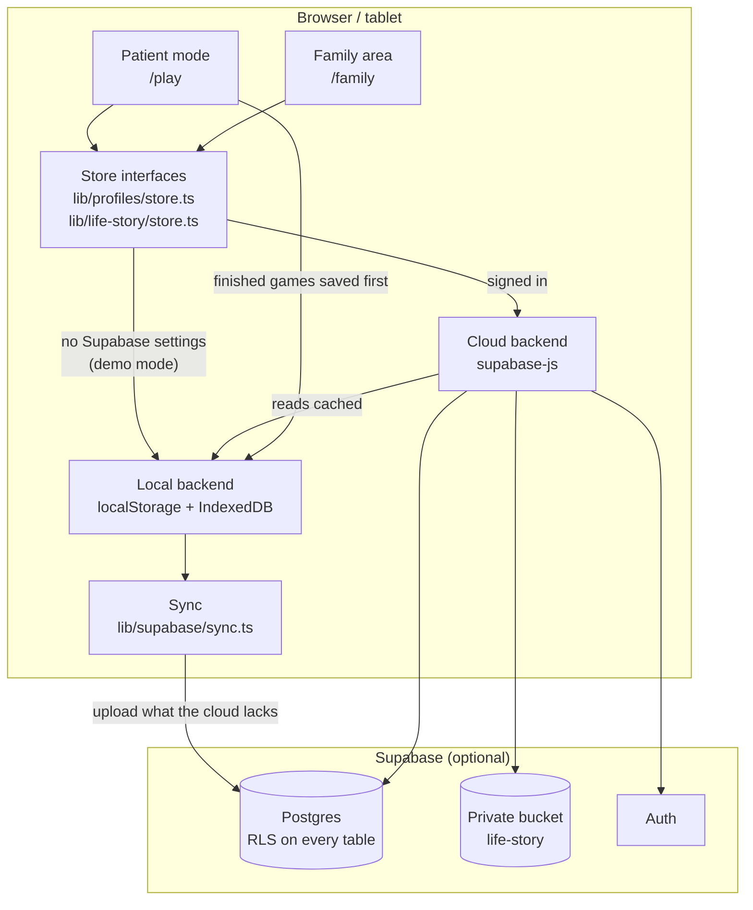

# Architecture

CogniCare is one Next.js app with two modes. Everything the person uses works from the device first; Supabase is an
optional backup and sharing layer. Without Supabase settings the whole app runs in **demo mode** on local storage only.

## Rules the diagram encodes

- **Screens never call Supabase directly.** They use a store interface, which picks the `local` or `cloud` backend.
- **Device first.** Games are saved on the device, then synced in the background. Cloud reads are cached on the device,
  and Life Story photos are cached in IndexedDB, so patient mode keeps working offline.
- **Owner-scoped data.** Every table has RLS; a signed-in account sees only the care profiles it owns. Photos live in a
  private bucket.
- **Patient mode has no login.** A carer signs in and opens patient mode for one person (`/play/[id]`). The exit PIN is
  a convenience lock, not security.

## Where things live

| Folder                 | What                                                              |
| ---------------------- | ----------------------------------------------------------------- |
| `app/play/**`          | Patient mode routes                                               |
| `app/family/**`        | Family area routes                                                |
| `components/play/**`   | Patient mode UI (`usePlay`, home, game access)                    |
| `components/family/**` | Family area UI                                                    |
| `lib/profiles/`        | Care profiles store, PIN, support levels                          |
| `lib/life-story/`      | Photos and names store, photo cache, resize                       |
| `lib/games/`           | Game rules, visibility, local session history                     |
| `lib/supabase/`        | Clients, env check (demo mode), auth helpers, sync                |
| `supabase/setup_cognicare.sql` | One-time setup for a new Supabase project |
| `e2e/`                 | Playwright tests (demo mode, production build, axe, phone widths) |
| `scripts/test-*.mjs`   | Unit tests (`node --test`)                                        |
